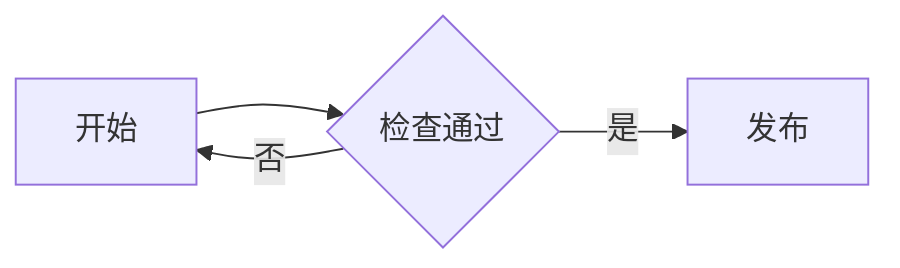

# Markdown 语法速查

本页汇总常用 Markdown 语法。详细说明与示例见 [第三次内训](training/session-03/index.md)。

| 排版功能 | 写法 |
| --- | --- |
| 一级标题 | `# 标题` |
| 二级标题 | `## 标题` |
| 粗体 | `**重要内容**` |
| 斜体 | `*重点词语*` |
| 行内代码 | `` `practice.md` `` |
| 无序列表 | `- 一项内容` |
| 有序列表 | `1. 第一步` |
| 引用 | `> 一段引用` |
| 链接 | `[说明文字](https://example.com)` |
| 图片 | `` |
| 已完成任务 | `- [x] 完成预习` |
| 未完成任务 | `- [ ] 完成练习` |
| 行内公式 | `$x^2$` |
| 独立公式 | 成对的 `$$` 包住公式，前后空行 |

## 代码块

````markdown
```python
print("Markdown example")
```
````

## 表格

```markdown
| 内容 | 状态 |
| --- | --- |
| 练习 | 进行中 |
```

## 折叠内容

```html
<details>
  <summary>语法检查说明</summary>
  <p>标记需要成对出现。</p>
</details>
```

## Mermaid

````markdown

````

## 数学公式

```text
$$
\bar{x} = \frac{\sum_{i=1}^{n} x_i}{n}
$$
```

表格、任务列表、图表和公式依赖渲染器支持。图片随文件保存，站内链接使用相对路径，分享前在目标平台检查一次。
