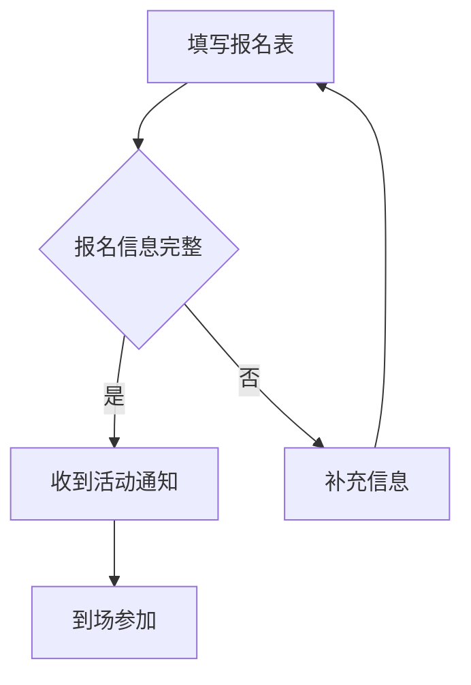

# 04 · Mermaid 流程图

**目标：** 用文字描述节点、连线与判断分支，画出一个完整的报名流程。

Mermaid 将特定格式的文本渲染为图表。代码块需要标注 `mermaid`，预览或网站也需要支持 Mermaid。

## 基础流程图

````markdown

````


- `flowchart` 指定流程图。
- `LR` 表示从左向右；改成 `TD` 可从上往下排列。
- `A`、`B`、`C` 是节点标识，方括号中是显示文字。
- `-->` 连接两个节点。

## 判断分支

````markdown

````


花括号表示判断节点，`|是|` 和 `|否|` 是连线上的说明。图表应先确定节点关系，再设置排列方向和节点文字。

## 常见错误

- 围栏语言标记为 `markdown` 时，预览仅显示代码文本。
- 节点括号不成对，或者漏写了连线符号。
- 节点文字太长，导致图表拥挤；可以把细节移到图外的段落。

本站与编辑器可能使用不同版本的 Mermaid。本课采用基础流程语法，实际文档仍需在目标网站中检查显示效果。

## 练习要求

绘制“安装 VS Code → 创建笔记 → 检查预览”的流程，并添加“显示正常”判断分支。

完成标准：至少四个节点，有一个判断节点，分支都能到达下一步或回到修改步骤。

[继续：LaTeX 数学公式](math.md)
