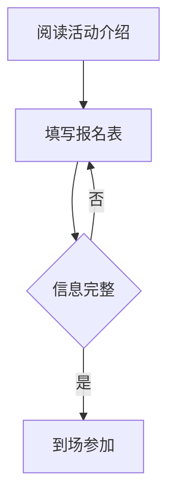

# 参考答案与说明

本页提供 [十二道填空练习](exercises.md) 的参考答案及语法说明。相同渲染效果可能对应多种写法，表中列出一组符合练习要求的示例。

| 题号 | 参考填入内容 | 语法说明 |
| --- | --- | --- |
| Q01 | `#` | 一级标题使用一个井号，后面留空格 |
| Q02 | 两处均填 `**` | 粗体标记包住需要强调的文字 |
| Q03 | `-` | 无序列表项以连字符和空格开头 |
| Q04 | `1.` | 有序列表标记包含数字和英文句点 |
| Q05 | `https://example.com/signup` | 链接圆括号中填写地址，此处为演示地址 |
| Q06 | `images/study-desk.png` | 图片位于练习文件旁的 `images` 文件夹 |
| Q07 | `\| --- \| --- \|` | 表格用分隔行区分表头与正文 |
| Q08 | `x` | `- [x]` 表示已完成 |
| Q09 | `markdown` | 围栏语言说明代码内容，便于高亮 |
| Q10 | 两处均填 `summary` | HTML 起始与结束标签匹配 |
| Q11 | 依次填 `mermaid`、`-->` | 前者启用图表渲染，后者连接节点 |
| Q12 | 依次填 `\sum_{i=1}^{n} x_i`、`n` | 所有评分之和除以评分数量 |

## 图表参考效果

## 公式参考效果

$$
\bar{x} = \frac{\sum_{i=1}^{n} x_i}{n}
$$

## 预览差异的检查方法

先确认文件扩展名、代码围栏和图片路径，再检查渲染器是否支持 Mermaid 与数学公式。HTML 容器内的内容也可能存在解析差异。练习包中的 HTML 内容使用普通 HTML 段落，便于检查。

作业包的 `reference/answers.md` 包含完整通知，可用于对照。填空完成后，可另行编写一份结构相同的活动说明，检查语法应用情况。

[重新下载作业包](../../assets/downloads/session-03-homework.zip) · [回到课程总览](index.md)
