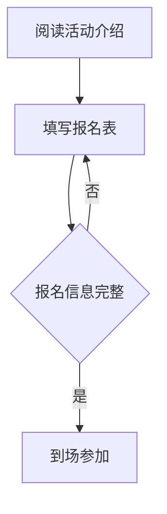

# 社团开放日活动通知

本次开放日包含**Markdown 文档编写练习**。

## 准备物品

- 一台安装好 VS Code 的电脑
- 已下载的练习文件

## 参与步骤

1. 到场签到
2. 打开练习文件
3. 与小组成员核对文档

[填写报名表](https://example.com/signup)


## 活动时间表

| 时间 | 安排 |
| --- | --- |
| 14:00 | 活动介绍 |
| 14:15 | 文档编写练习 |

## 环境准备状态

- [x] 安装 VS Code
- [ ] 完成填空练习

## Markdown 源码示例

```markdown
# 活动记录

本次课程使用 **Markdown** 编写文档。
```

## 参加要求

<details>
  <summary>设备与软件要求</summary>
  <p>参加者需准备电脑，提前安装 VS Code，并下载本次练习包。</p>
</details>

## 报名流程



## 活动评分

假设收集了 $n$ 份评分，每份记为 $x_i$。

$$
\bar{x} = \frac{\sum_{i=1}^{n} x_i}{n}
$$

## 学习记录

已掌握的语法：按实际掌握情况填写。

需要复习的语法：按实际复习需求填写。

## 对照说明

| 题号 | 填入内容 | 提示 |
| --- | --- | --- |
| Q01 | `#` | 后面留空格 |
| Q02 | 两处 `**` | 强调标记成对出现 |
| Q03 | `-` | 后面留空格 |
| Q04 | `1.` | 使用英文句点 |
| Q05 | `https://example.com/signup` | 演示地址，实际活动需替换 |
| Q06 | `images/study-desk.png` | 相对于 worksheet.md 的图片路径 |
| Q07 | `\| --- \| --- \|` | 两列对应两段分隔符 |
| Q08 | `x` | 小写 x 表示勾选 |
| Q09 | `markdown` | 指定代码块内容的语言 |
| Q10 | 两处 `summary` | 起始与结束标签一致 |
| Q11 | `mermaid`、`-->` | 图表语言、有向连线 |
| Q12 | `\sum_{i=1}^{n} x_i`、`n` | 求和后除以数量 |

本参考文件放在 reference 目录，因此它的示例图片路径是 `../images/study-desk.png`；作业文件的答案仍为 `images/study-desk.png`。
